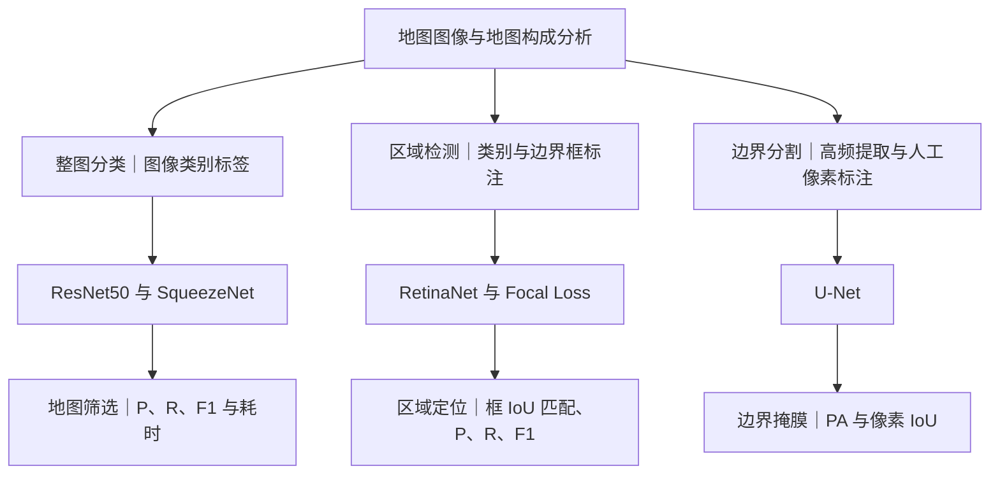

# Day 10｜地图识别与语义信息提取

**学习内容**　从研究问题出发，读懂三组实验和指标的证据范围。  
**难度**　中等。  
**预计学习时长**　35–45 分钟。

研一方向按项目中的**地图视觉语言模型（VLM）**理解。下文把原文报告、据此作出的判断和你可以设计的新实验分开。[论文正式版](https://doi.org/10.5194/ica-proc-5-25-2023)

## 二、研究背景

1. **背景。** 网络地图图像和历史纸质地图集蕴含地理信息。传统方法依赖人工或人机交互，难以跟上海量图像的处理需求。同一个区域还可能因投影、比例尺和绘制风格不同而呈现不同外观。作者从制图的逆过程切入，研究怎样从地图图像中识别和提取地理要素。[原文第 1、3、6 页](https://ica-proc.copernicus.org/articles/5/25/2023/ica-proc-5-25-2023.pdf#page=1)
2. **问题。** 可以按输出粒度拆成三问。这张图是不是地图？指定地理区域在哪里？目标边界具体经过哪些像素？三问分别需要图像类别、边界框和像素掩膜。分类实验中的两类示意是地图与人物，因此引用时宜称“筛选地图图像”。[原文图 2–3、第 3–4 节](https://ica-proc.copernicus.org/articles/5/25/2023/ica-proc-5-25-2023.pdf#page=2)
3. **价值。** 分类可以帮助批量筛选地图，检测可以为人工复核或后续分析缩小范围，分割可以为边界提取、矢量化和空间分析提供像素级输入。后两项下游用途是潜在应用，本文直接评测的是类别、框和掩膜。[原文第 1、4、5 节](https://ica-proc.copernicus.org/articles/5/25/2023/ica-proc-5-25-2023.pdf#page=1)

## 三、研究方法

- **全图分类（第 2 节）。** 对比残差网络 ResNet50 和轻量网络 SqueezeNet。输入整张图，输出类别。研究关注分类表现和资源开销之间的取舍。
- **区域检测（第 3 节）。** 用人工框标注台湾、西藏和中国大陆三个目标。RetinaNet 用主干网络和特征金字塔提取多尺度特征，再由两个分支预测类别和框位置。Focal Loss 降低易分类样本的损失权重，让训练更关注难例。
- **边界分割（第 4 节）。** 先提取图像高频特征，再人工修订像素标注。用 U-Net 的编码、解码和跳跃连接预测线状边界掩膜。原文将高频处理称为“拉普拉斯变换”，未给出可确认其具体实现的公式。

按第 2–4 节的组织方式，这三项是分别训练和评估的实验。论文报告了各分支的结果，未报告把三项模型串接后的端到端实验。[原文第 2–4 节](https://ica-proc.copernicus.org/articles/5/25/2023/ica-proc-5-25-2023.pdf#page=2) · [Focal Loss 原始论文](https://arxiv.org/abs/1708.02002)

## 四、实验评估

### 1. 分类｜有没有选对地图？成本多大？

**论文怎么做。** 作者报告随机划分出 73,933 幅训练图和 14,787 幅测试图，在相同条件下比较两种模型的 P、R、F1 和训练、测试总耗时。图 5 中 ResNet50 为 685 分钟训练、45 分钟测试，SqueezeNet 为 273 分钟训练、7 分钟测试。结合图 4，作者报告 ResNet50 的 P、R 更高，SqueezeNet 的耗时更低。[原文第 2.3 节、图 4–5](https://ica-proc.copernicus.org/articles/5/25/2023/ica-proc-5-25-2023.pdf#page=2)

**怎么算，什么时候用。** 以“地图”为正类，P（精确率）是预测为地图的图像中真地图的比例，适合关注误收。R（召回率）是真地图中被找回的比例，适合关注漏收。F1 = 2PR/(P+R)，适合同时关注两类错误。总耗时适合比较同一测试规模下的资源开销。比较部署速度时，可固定设备、输入尺寸和批大小，报告单图延迟、P95 延迟、吞吐量与峰值显存。

**其他常用评法。** 准确率衡量整体判对比例，适合类别分布和错误代价相近的任务。类别失衡且希望各类同等重要时可报告宏平均 F1。混淆矩阵能定位哪些类别容易混淆。二分类输出连续分数且正类稀少时，可用 PR 曲线和 AP 观察不同置信度阈值的取舍。原文未详述图 4 的平均方式，复现时应写明是地图正类还是按类别平均。[scikit-learn 评估文档](https://scikit-learn.org/stable/modules/model_evaluation.html)

### 2. 检测｜地区找到了吗？框得准吗？

**论文怎么做。** 表 1 报告 3,192 个训练目标样本、799 个测试目标样本。把预测框与同类真实框比较，用框的交并比衡量定位重叠，再按匹配结果统计各类别的 P、R、F1。表 3 中，中国大陆类别的 P = 0.52、R = 0.94、F1 = 0.67。在该评测口径下，大部分真实目标被找回，但预测为该类的结果中约 48% 未被计为正确检测。表格无法区分这些失败来自定位偏差、重复框还是错检。[原文第 3.2 节、表 1–3](https://ica-proc.copernicus.org/articles/5/25/2023/ica-proc-5-25-2023.pdf#page=4)

**怎么算，什么时候用。** 框 IoU = 两框交集面积 ÷ 并集面积。需要规定同类框的匹配方式、IoU 阈值和置信度规则，才能判断哪些框算检测成功。原文说明用 IoU 阈值判断匹配，未报告具体阈值或完整匹配细节。固定工作点的 P、R、F1 适合回答部署时的误检和漏检问题，IoU 适合衡量框与标注的空间重叠。

**其他常用评法。** AP 汇总不同置信度下的精确率与召回率。AP50 使用 0.50 的 IoU 阈值，适合关注能否大致定位。COCO 主指标在 IoU 0.50 至 0.95 的 10 个阈值上综合 AP，并对类别汇总，能更细致地区分定位质量。研究小图标或密集注记时，也可按目标尺寸分别报告 AP。[COCO 官方检测评测](https://github.com/cocodataset/cocodataset.github.io/blob/master/dataset/detection-eval.htm)

### 3. 分割｜边界像素有没有画对？

**论文怎么做。** 作者标注了 48 个训练样本和 17 个测试样本，展示测试图与预测掩膜。表 4 列了 4 幅典型测试图，表中均值为 PA 85.58%、IoU 82.32%。表中没有给出全部 17 个样本的汇总依据，因此引用时应明确是表 4 所列样例的结果。[原文第 4.3 节、图 9–10、表 4](https://ica-proc.copernicus.org/articles/5/25/2023/ica-proc-5-25-2023.pdf#page=5)

**怎么算，什么时候用。** PA（像素准确率）= 判对的像素数 ÷ 全部像素数，反映整图像素分类表现。像素 IoU = 预测前景与真实前景的交集像素数 ÷ 并集像素数，更适合看边界掩膜的重叠。假如边界只占 1% 像素，全部预测成背景也会得到 99% 的 PA，此时前景 IoU 为 0。这个例子说明细线任务需要单独看前景指标。

**其他常用评法。** 多类分割可用 mIoU，先算每类 IoU 再取平均。稀疏前景可补充 Dice，衡量两份掩膜的重叠。如果研究问题更关注边界位置，可以报告 Boundary IoU。要测断线或连通性，需另外定义面向拓扑的评价。[Cityscapes 评测说明](https://www.cityscapes-dataset.com/benchmarks/) · [Boundary IoU 原始论文](https://arxiv.org/abs/2103.16562)

## 五、核心贡献

这篇文章的主要贡献在**地图任务的组织和应用验证**。它把地图图像中的信息提取分成整图、区域与像素三个层级，为各层级明确了标注形式、模型和评价指标。分类部分还比较了性能与运行成本，分割部分尝试用高频特征辅助人工标注。ResNet50、SqueezeNet、RetinaNet 和 U-Net 都是已有模型。高频辅助标注有没有节省时间，仍需要单独的对照实验。[原文第 2–4 节](https://ica-proc.copernicus.org/articles/5/25/2023/ica-proc-5-25-2023.pdf#page=2)

## 六、证据和局限

1. **跨地图来源的泛化证据有限。** 论文指出投影、比例尺和风格会影响识别，但未展示按这些因素或地图来源分组的独立外部测试。当前结果主要说明所用测试数据上的表现。
2. **复现所需信息不全。** 分类报告总数为 92,543，训练和测试相加为 88,720，剩余 3,823 幅用途未交代。检测没有给出具体 IoU 阈值和完整匹配细节，分割只列出 4 幅图的详细数值。
3. **对照力度不均。** 分类有两个模型的比较，检测和分割缺少在相同数据与协议下的模型对照。原文也未展示去掉 Focal Loss 或高频辅助标注的消融。现有结果可说明流程有可行性，难以把收益归因到某个组件。
4. **语义覆盖仍有限。** 评估集中在地图筛选、三类区域框和一种线状边界。结论提及地图注记识别，但正文没有对应的 OCR 评测，也没有展示注记与对象关联、空间关系推理或端到端的地理数据生成。[原文第 2.3、3.2、4.3、5 节](https://ica-proc.copernicus.org/articles/5/25/2023/ica-proc-5-25-2023.pdf#page=2)

## 七、对地图 VLM 研一项目的借鉴

- **先定任务和证据。** 延续 Day 9 对地图字符、符号和对象形态的观察，把“模型读懂了地图”改写成一个可核验的问题。可以从“某个站名对应哪个站点符号”入手，把文字识别、符号定位和配对判断分别记录。
- **只改变一个条件。** 例如用同一批图和同一组问题比较“VLM 只看图”与“VLM 看图并获得 OCR 文字和位置”。同时记录答案正确率与配对正确率，就能区分模型是否只是读对了字，还是找到了文字对应的对象。
- **把地图来源作为划分单位。** 同一地图的裁片或近重复图像放在同一集合。尽量留出一种未见来源或风格测试，并按文字误读、对象漏检、关联错误分类检查失败案例。

**你的阅读卡练习（10 分钟）。** 先从第 2.3、3.2、4.3 节各选一个最能说明问题的结果，每个结果写一句“它支持什么”和一句“还需要什么证据”。再从 Day 9 的两幅城市地图里挑一幅，写出一个待检验的 VLM 假设、一个对照组和一个主指标。验收时检查三点：结论能指回图表、指标对应模型输出、对照组只改变一个条件。

## 八、整体研究框架

箭头表示各分支内从数据到评估的顺序。三条分支分别对应论文第 2、3、4 节。
