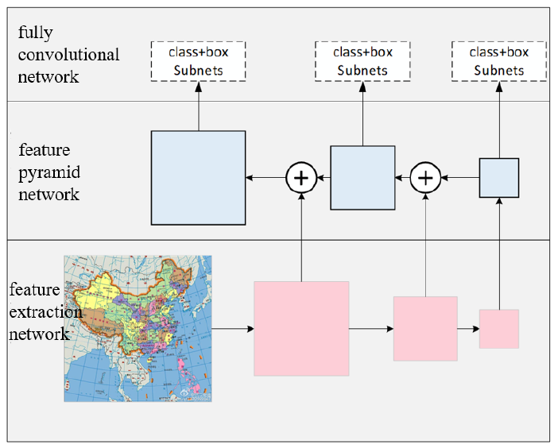
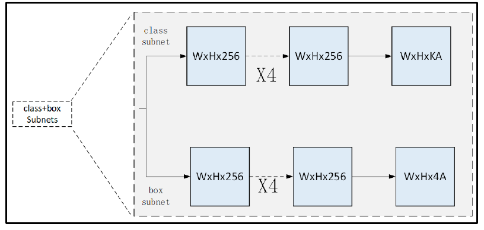
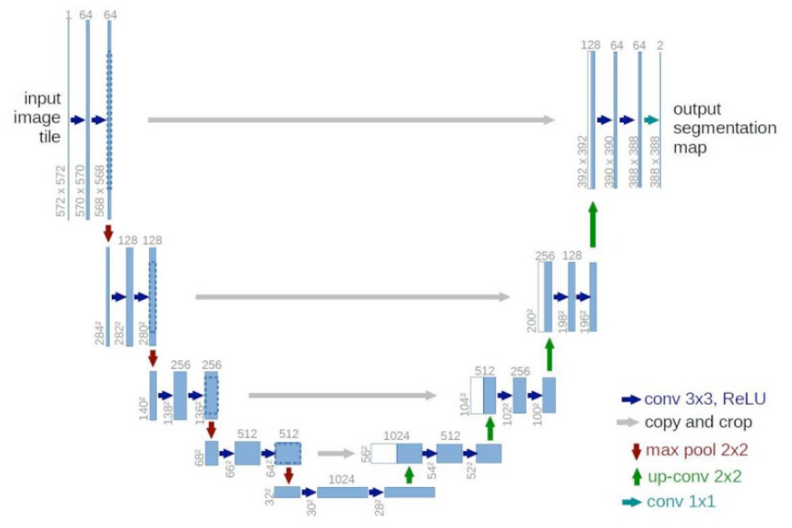
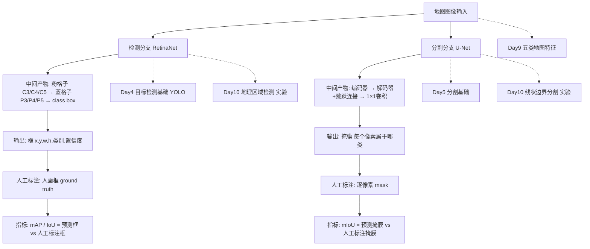

# Day 11｜方法图精读：从地图输入到框、掩膜与指标

**学习内容**　细读论文图 6–8（RetinaNet、双分支子网络、U-Net），画一张「输入 → 输出 → 标注 → 评价指标」流程图，把方法放回自己的知识树。
**难度**　中等偏上（第一次按张量形状读网络结构图）。
**预计学习时长**　50–60 分钟，今天不跑代码、不训练。

昨天你已经把三条实验分支的**指标口径**理清了。今天往里走一层：同一张地图，模型内部是怎么分别变成「框」和「掩膜」的。

## 材料（都在本项目里）

- 图 6 RetinaNet 结构：`images/ica-map-recognition-2023/figure-06.png`
- 图 7 分类 / 框回归子网络：`images/ica-map-recognition-2023/figure-07.png`
- 图 8 U-Net 结构：`images/ica-map-recognition-2023/figure-08.png`
- `基于深度学习的地图识别与语义信息提取_中文译文.md` 第 3、4 节
- `Day10_地图识别与语义提取论文导读.md` 第四节

## 任务 1｜读 RetinaNet 的两张图（15 分钟）

**目标**：说清数据从输入到输出，形状和信息发生了什么变化。
**产出**：一张三行手写表「模块 / 输入 / 输出」，对应图 6 的三层；再给图 7 的两个分支各写一句话。
**验收**（口头讲给自己听即可）：
1. 图 6 粉色方块为什么越往右越小？为什么还要把右边的小图「加」回左边？
2. 图 6 每一层都挂一对子网络，说明「大目标和小目标」是靠什么区分处理的？
3. 图 7 里 `W×H×KA` 和 `W×H×4A` 的 `K`、`A`、`4` 各指什么？提示：回忆 Day4 一个框要几个数。

**想一想**：如果只留最右边那张最小的特征图，地铁站图标这类小目标会怎样？把猜测和理由写下来。

## 任务 2｜读 U-Net 图（15 分钟）

**目标**：理解「先压缩、再还原」为什么适合逐像素任务。
**产出**：在图 8 的打印件或纸上标出一次下采样、一次上采样后的高宽与通道变化（写相对倍数即可），并圈出一处跳跃连接。
**验收**：
1. 池化后空间变小，为什么通道数反而加倍？
2. 跳跃连接把哪一侧的什么信息送到哪一侧？细线边界为什么特别需要它？
3. 最后那步 `1×1` 卷积的作用是什么？

**想一想**：拿掉跳跃连接，预测出的道路边界最可能出什么问题？可以回看 Day10 里「漏掉路口少量像素会让道路断开」那句。

## 任务 3｜今日主产出：画流程图（20 分钟）

**目标**：把 Day10 的「三条分支做什么」细化成「每条分支内部怎么流、怎么算分」。
**工具**：纸笔拍照、draw.io 或 mermaid 都行，存到 `images/day11_flow.png` 或 `Day11_flow.md`。

**图上必须能找到这些元素**（顺序和连法由你自己决定，我不给答案）：

- 一个共同的起点：地图图像输入
- 两条分支，各自经过的中间产物（特征图 / 编码解码结果）
- 两种输出：`(x, y, w, h, 类别, 置信度)` 的框、`H×W` 的掩膜
- 两条分支各自需要的**人工标注**是什么
- 两条分支各自的**评价指标**，以及指标是拿「输出」和「谁」比较算出来的
- 至少两处虚线，连回你的旧笔记：Day4 检测、Day5 分割、Day9 五类地图特征、Day10 三组实验

**验收标准**：① 指着一个箭头能说出传的是什么形状的数据；② 每个指标都能指回它比较的两个对象；③ 图里能看出「标注」不是模型输出，而是人工给定的对照。

### 流程图成品（mermaid，可直接在 MarkText / GitHub 渲染）

## 任务 4｜把方法放回知识树（5–10 分钟）

写三句话，不求长：

1. Day9 的五类地图特征里，哪一类最适合交给检测分支、哪一类交给分割分支？为什么？
2. 论文这两条分支有没有解决「文字与对应对象关联」？回 Day10 第六节找依据。
3. 如果明天加一条 OCR 分支，它需要什么标注、什么指标？

### 三句话（你的回答，已整理）

1. **特征分派**：**细小的（线状边界、道路、河流等）交给分割**，**大块的（区域、成片目标）交给检测**。依据：Day10 里检测实验就是用框标「台湾、西藏、中国大陆」这类大块区域，分割实验才是逐像素勾线状边界——细小/连续的东西框不住，大块目标用框更合适。
2. **文字-对象关联**：**没有解决**。Day10 第六节第 4 点明确：正文「没有展示注记与对象关联、空间关系推理」，只提了地图注记识别却无对应 OCR 评测；检测 / 分割两条分支都不出现文字与对象的对应。
3. **加 OCR 分支**：除了识别文字，还要**看它与哪个板块的物体距离最近，和最近的做匹配**（关联）。因此标注需文字框 + 文字真值，还要有物体框作匹配基准；指标除文字检测的 AP / IoU、识别的 CER / WER 外，还应加一项「关联 / 配对正确率」。

## 交作业与复盘

把**流程图**和**三句话**发我，我按「逻辑是否连贯、结论能否指回图、术语是否准确」逐条评审，用提问带你自己定位问题，不直接改图。

今天汇报学习情况后，我按固定四项（今日完成内容 / 遇到的问题 / 解决情况 / 明日计划）写 Markdown 日志，追加到 `notes.md`，可直接粘贴到 GitHub。

> 小提醒：图 7 的 `K`、`A` 这类符号若一时拿不准，写下你的**猜想 + 依据 + 待核实**就算合格产出——这正是 Day10 里养成的复现习惯。今天只求读通图，不贪多。
